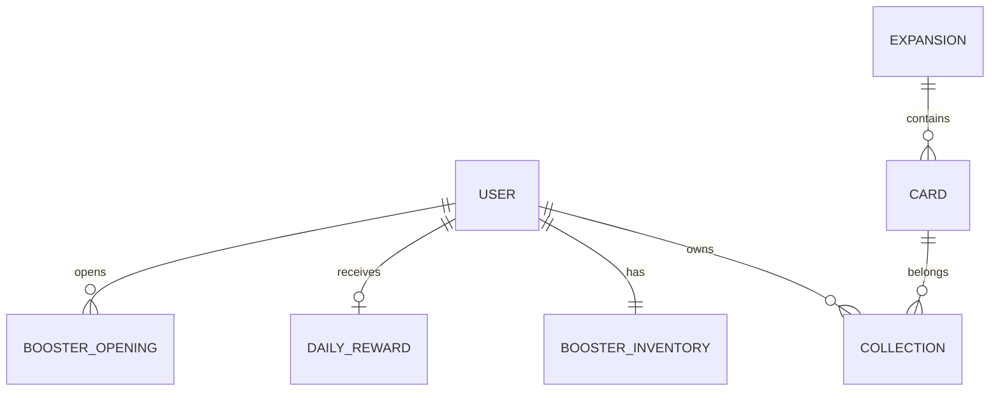

# MONADEX — Contextualização e diretrizes de desenvolvimento

## 1. Identidade do projeto

- **Nome:** Monadex — A Functional Card Collection
- **Categoria:** Simulador de abertura de boosters e colecionismo.
- **Tema:** Pokémon Trading Card Game.
- **Finalidade:** Projeto acadêmico desenvolvido em dupla.
- **Linguagem:** Haskell.
- **Framework web:** Yesod.
- **Banco de dados:** PostgreSQL.
- **Persistência:** Persistent.
- **Arquitetura do backend:** Aplicação Yesod modular com contratos HTTP/JSON; a interface é desenvolvida separadamente.
- **Objetivo acadêmico:** Demonstrar a aplicação prática de programação funcional e mônadas.

O Monadex é uma aplicação web que simula a experiência de um colecionador de cartas Pokémon TCG. O usuário poderá criar uma conta, receber boosters gratuitamente, abrir pacotes de cartas virtuais, organizar sua coleção e acompanhar seu progresso nas diferentes expansões disponíveis.

O sistema não pretende reproduzir as mecânicas de combate do Pokémon TCG. Seu foco é exclusivamente a experiência de colecionismo.

O nome Monadex representa a combinação dos conceitos de Monad e Pokédex, relacionando programação funcional com a temática do projeto.

### Escopo vigente da equipe

Este documento conserva a contextualização acadêmica original, mas o escopo do agente de backend é **exclusivamente** Haskell, Yesod, Persistent, PostgreSQL, regras, integração, testes e documentação técnica. A outra integrante desenvolve o frontend separadamente e escolhe suas tecnologias; não existe obrigação de utilizar Hamlet, Lucius, Julius, SSR ou qualquer framework específico de frontend. Os **contratos HTTP/JSON** são a interface principal de integração entre as duas partes. Recomendações visuais abaixo não são tarefas para o agente de backend. Para versionamento, siga obrigatoriamente `AGENTS.md` e `GIT_WORKFLOW.md`, inclusive as autorizações independentes de commit e push na branch `monadex-backend`.

---

## 2. Diretrizes para o agente de desenvolvimento

Atue como um engenheiro de software especializado em Haskell, Yesod, PostgreSQL e programação funcional.

Antes de implementar qualquer funcionalidade:

1. Analise o diretório atual e identifique os arquivos existentes.
2. Verifique as ferramentas e versões disponíveis no ambiente.
3. Identifique se já existe um scaffold Yesod.
4. Verifique a disponibilidade do Docker e Docker Compose.
5. Apresente um plano de implementação.
6. Preserve arquivos e configurações existentes que sejam válidos.
7. Desenvolva o sistema incrementalmente.
8. Compile e teste cada etapa antes de prosseguir.
9. Documente as decisões arquiteturais relevantes.
10. Não declare funcionalidades concluídas sem verificar sua implementação.

O ambiente de desenvolvimento utiliza Linux, especificamente Zorin OS, baseado no Ubuntu.

Não reinstale ferramentas que já estejam disponíveis e não execute comandos destrutivos, instalações globais ou alterações nas configurações do sistema operacional sem autorização.

Caso existam incompatibilidades entre versões de bibliotecas, investigue a causa antes de alterar dependências.

Priorize:

- Simplicidade.
- Legibilidade.
- Modularização.
- Segurança.
- Programação funcional.
- Separação de responsabilidades.
- Facilidade de manutenção.
- Facilidade de apresentação acadêmica.

Evite overengineering, abstrações desnecessárias e dependências que não contribuam diretamente para o projeto.

---

## 3. Stack tecnológica

Utilize preferencialmente:

| Tecnologia | Responsabilidade |
|---|---|
| Haskell | Linguagem principal |
| Yesod | Framework web |
| PostgreSQL | Banco de dados |
| Persistent | ORM e persistência |
| persistent-postgresql | Integração com PostgreSQL |
| Aeson | Processamento de JSON |
| http-conduit ou equivalente | Requisições HTTP |
| random | Geração de números aleatórios |
| mtl | Mônadas e transformadores |
| containers | Estruturas de dados |
| time | Manipulação de datas |
| text | Manipulação de textos |
| Hspec | Testes automatizados |
| QuickCheck | Testes baseados em propriedades, quando aplicável |
| Docker Compose | Ambiente PostgreSQL |
| Stack | Gerenciamento do projeto e compilação |

As versões das dependências deverão ser compatíveis com o resolver utilizado pelo projeto.

Utilize uma biblioteca consolidada para armazenamento seguro de senhas.

O backend permanece em Haskell/Yesod, sem um backend paralelo em Node.js. A escolha de ferramentas e frameworks do frontend pertence à outra integrante; esta seção não a restringe.

---

## 4. Arquitetura do sistema

O backend deverá utilizar uma arquitetura modular, separando handlers JSON, domínio, serviços e persistência. A apresentação visual pertence à outra integrante.

Fluxo arquitetural:

```text
Browser
   |
   v
Frontend separado
Contratos HTTP/JSON com Yesod
   |
   v
Handlers
Rotas / Autenticação / Requisições
   |
   v
Domain & Services
Regras de negócio / Mônadas
   |
   +-------------------+
   |                   |
   v                   v
Persistent         Card API
PostgreSQL         HTTP / JSON
```

Os handlers não deverão concentrar toda a lógica de negócio.

As regras de sorteio, validação, gerenciamento de boosters e transformação do estado do jogador deverão permanecer, sempre que possível, independentes do framework web.

A estrutura abaixo é uma referência e deverá ser adaptada ao scaffold oficial utilizado:

```text
monadex/
├── app/
│   └── Main.hs
├── src/
│   ├── Application.hs
│   ├── Foundation.hs
│   ├── Import.hs
│   ├── Model.hs
│   ├── Settings.hs
│   │
│   ├── Domain/
│   │   ├── Card.hs
│   │   ├── Rarity.hs
│   │   ├── Player.hs
│   │   ├── Booster.hs
│   │   └── Error.hs
│   │
│   ├── Handler/
│   │   ├── Home.hs
│   │   ├── Auth.hs
│   │   ├── Dashboard.hs
│   │   ├── Booster.hs
│   │   ├── Collection.hs
│   │   └── Expansion.hs
│   │
│   ├── Service/
│   │   ├── CardAPI.hs
│   │   ├── CardImportService.hs
│   │   ├── AuthService.hs
│   │   ├── BoosterService.hs
│   │   ├── CollectionService.hs
│   │   └── DailyRewardService.hs
│   │
│   └── Repository/
│       ├── CardRepository.hs
│       ├── UserRepository.hs
│       └── CollectionRepository.hs
│
├── config/
│   ├── models
│   ├── routes
│   └── settings.yml
│
├── test/
│   ├── Spec.hs
│   └── Domain/
│
├── docs/
├── docker-compose.yml
├── .env.example
├── .gitignore
├── package.yaml
├── stack.yaml
└── README.md
```

A camada Repository é opcional. Caso o uso direto de Persistent nos serviços seja suficiente, não crie uma abstração redundante.

---

## 5. Escopo funcional

### RF01 — Cadastro de usuários

O sistema deverá permitir a criação de contas utilizando:

- Nome de usuário.
- Senha.
- Confirmação de senha.

O nome de usuário deverá ser único.

As senhas nunca deverão ser armazenadas em texto puro.

### RF02 — Autenticação

O usuário deverá conseguir:

- Realizar login.
- Realizar logout.
- Manter uma sessão autenticada.
- Acessar exclusivamente seus próprios dados.

Rotas privadas deverão exigir autenticação.

### RF03 — Dashboard

O endpoint de dashboard deverá fornecer ao frontend:

- Nome do usuário.
- Quantidade de boosters disponíveis.
- Quantidade total de cartas adquiridas.
- Quantidade de cartas únicas adquiridas.
- Quantidade de cartas por raridade.
- Progresso geral da coleção.
- Situação da recompensa diária.
- Acesso à abertura de boosters.

### RF04 — Inventário de boosters

Cada usuário possuirá seu próprio inventário.

Regras:

- A quantidade de boosters deverá ser persistida.
- A abertura de um pacote consumirá exatamente um booster.
- O inventário não poderá assumir valores negativos.
- O usuário não poderá abrir boosters que não possui.
- A quantidade não deverá ser modificável diretamente pelo frontend.

Inicialmente existirá apenas um tipo de booster.

### RF05 — Abertura de boosters

Cada booster deverá conter exatamente seis cartas.

As cinco primeiras cartas seguirão a distribuição geral de raridades.

A sexta carta deverá obrigatoriamente possuir raridade Incomum ou superior.

Cartas repetidas serão permitidas, inclusive dentro do mesmo pacote.

Ao abrir um booster:

1. Verificar a autenticação.
2. Validar a disponibilidade de boosters.
3. Validar a disponibilidade de cartas no catálogo.
4. Sortear as seis cartas.
5. Consumir um booster.
6. Atualizar a coleção.
7. Persistir as alterações de maneira atômica.
8. Retornar as seis cartas obtidas.
9. Disponibilizar o resultado ao frontend via contrato JSON; a apresentação é responsabilidade da outra integrante.

Caso ocorra uma falha, não deverá existir consumo parcial de boosters ou atualização incompleta da coleção.

O sorteio deverá ocorrer exclusivamente no backend.

O sistema será exclusivamente gratuito, sem compras de boosters, apostas, conversão de cartas em dinheiro ou mecanismos de monetização.

### RF06 — Recompensa diária

Cada usuário poderá receber um booster gratuito por dia.

Regras:

- A recompensa será concedida automaticamente no primeiro acesso autenticado elegível do dia.
- O último dia de concessão deverá ser persistido.
- O acesso repetido no mesmo dia não concederá novos boosters.
- Reiniciar o sistema não permitirá receber recompensas adicionais.
- A recompensa será vinculada à conta do usuário.
- Requisições simultâneas não poderão gerar recompensas duplicadas.
- Utilize a data do servidor convertida para o fuso horário America/Sao_Paulo.

Não confie na data fornecida pelo navegador.

O dashboard deverá informar se a recompensa daquele dia já foi concedida.

### RF07 — Minha coleção

A coleção deverá permitir:

- Visualizar cartas adquiridas.
- Visualizar a quantidade de cópias.
- Filtrar por raridade.
- Filtrar por expansão.
- Buscar pelo nome da carta.
- Identificar cartas ainda não adquiridas.
- Acompanhar o progresso da coleção.

Caso o usuário obtenha novamente uma carta existente, incremente sua quantidade em vez de criar um registro duplicado.

### RF08 — Expansões

O sistema deverá permitir:

- Listar as expansões importadas.
- Visualizar as cartas de uma expansão.
- Identificar cartas adquiridas e não adquiridas.
- Exibir a quantidade de cartas únicas obtidas.
- Exibir o total de cartas da expansão.
- Calcular o progresso percentual.

O progresso deverá considerar cartas únicas, e não o total de cópias.

---

## 6. Sistema de raridades

O Monadex utilizará quatro categorias simplificadas:

```haskell
data Rarity
    = Common
    | Uncommon
    | Rare
    | UltraRare
    deriving (Show, Read, Eq, Ord, Enum, Bounded)
```

Distribuição das cinco primeiras cartas:

| Raridade | Probabilidade |
|---|---:|
| Common | 60% |
| Uncommon | 25% |
| Rare | 10% |
| UltraRare | 5% |

Para a sexta carta, utilize provisoriamente os pesos relativos das raridades permitidas, excluindo Common:

| Raridade | Probabilidade |
|---|---:|
| Common | 0% |
| Uncommon | 62,5% |
| Rare | 25% |
| UltraRare | 12,5% |

A distribuição da sexta carta é uma proposta técnica inicial e deverá permanecer configurável no domínio.

As probabilidades são fictícias e não representam necessariamente as taxas oficiais do Pokémon TCG.

O sorteio deverá ocorrer em duas etapas:

1. Determinar a raridade.
2. Selecionar uma carta aleatória pertencente àquela raridade.

Valide previamente se existem cartas disponíveis nas quatro categorias.

Não altere silenciosamente as probabilidades caso determinada categoria esteja vazia. Retorne um erro de domínio e preserve o inventário do usuário.

---

## 7. Aplicação da programação funcional e das mônadas

Esta seção representa o principal objetivo acadêmico do projeto.

As mônadas não deverão ser utilizadas apenas como exemplos artificiais. Elas deverão estar presentes em operações reais do sistema.

### IO

Utilização:

- Requisições HTTP.
- Comunicação com serviços externos.
- Geração de aleatoriedade.
- Leitura de configurações.
- Operações de entrada e saída.

### Maybe

Utilização:

- Busca de cartas.
- Busca de usuários.
- Datas de recompensa ainda inexistentes.
- Informações opcionais retornadas pela API.

Exemplo conceitual:

```haskell
findCard :: CardId -> [Card] -> Maybe Card
```

### Either

Utilização:

- Validação das regras de negócio.
- Tratamento explícito de falhas.
- Inventário insuficiente.
- Catálogo incompleto.
- Recompensa diária duplicada.

Exemplo:

```haskell
data GameError
    = InsufficientBoosters
    | DailyRewardAlreadyClaimed
    | EmptyCardPool Rarity
    | CardNotFound
    | InvalidBooster
    | InvalidPlayerState
    deriving (Show, Eq)
```

### State

Utilização:

- Representar o estado do jogador.
- Transformar seu inventário.
- Atualizar sua coleção em memória.
- Representar alterações determinísticas decorrentes de uma abertura.

Exemplo conceitual:

```haskell
data PlayerState = PlayerState
    { boosterCount :: Int
    , collection   :: Map CardId Int
    , lastClaim    :: Maybe Day
    } deriving (Show)
```

### StateT combinado com Either

Utilize, quando adequado, transformadores de mônadas para representar operações que alteram o estado e podem falhar.

Exemplo:

```haskell
openBooster
    :: [CardId]
    -> StateT PlayerState (Either GameError) [CardId]
```

A função deverá validar as cartas recebidas e as condições do jogador antes de transformar seu estado.

Essa assinatura é uma referência arquitetural, não uma obrigação caso outra solução funcional seja mais apropriada.

### Handler e SqlPersistT

Documente também as abstrações monádicas utilizadas naturalmente pelo Yesod e Persistent.

O PostgreSQL será a fonte persistente de verdade.

A mônada State não deverá substituir o banco de dados nem armazenar globalmente o estado de usuários entre requisições.

### Outros conceitos funcionais

Sempre que aplicável, utilize:

- Tipos algébricos.
- Pattern matching.
- Funções puras.
- Imutabilidade.
- Composição de funções.
- Funções de ordem superior.
- Map e Filter.
- Folds.
- Typeclasses.
- Separação entre funções puras e efeitos colaterais.

Evite concentrar toda a aplicação em funções IO.

Evite funções parciais, como `head`, `fromJust`, `undefined` e `error`, em fluxos de produção.

---

## 8. Integração com API externa

O catálogo deverá utilizar informações reais de cartas Pokémon TCG.

Considere inicialmente a API TCGdex como fornecedora de dados:

- Documentação: https://tcgdex.dev/
- API: https://api.tcgdex.net/v2/en

Antes de implementar, valide a disponibilidade da API, seus endpoints, formatos de resposta e condições de utilização.

Não presuma que todos os campos estejam disponíveis.

A integração deverá obter:

- Identificador externo da carta.
- Nome.
- Pokémon correspondente, quando aplicável.
- Raridade original.
- Expansão.
- Número da carta na expansão.
- URL da imagem.
- Identificador externo da expansão.
- Nome da expansão.

A API poderá apresentar mais categorias de raridade do que as quatro utilizadas pelo Monadex.

Crie uma função explícita de normalização:

```haskell
normalizeRarity :: Text -> Maybe Rarity
```

Raridades desconhecidas não deverão ser classificadas arbitrariamente como Common.

Documente o mapeamento entre as raridades originais e as categorias do Monadex.

### Estratégia de integração

```text
API externa
    |
    v
Requisição HTTP
    |
    v
Desserialização JSON com Aeson
    |
    v
Validação dos dados
    |
    v
Normalização das raridades
    |
    v
Persistência no PostgreSQL
    |
    v
Catálogo local de cartas
```

O PostgreSQL deverá funcionar como catálogo local.

Não realize requisições à API a cada abertura de booster.

Implemente um mecanismo de importação idempotente, evitando duplicação de cartas e expansões caso a importação seja executada novamente.

Comece com uma expansão que possua dados suficientes para atender às quatro categorias de raridade.

Implemente tratamento de:

- Timeouts.
- Falhas HTTP.
- JSON inválido.
- Campos ausentes.
- Raridades desconhecidas.
- Registros duplicados.
- Indisponibilidade temporária da API.

Dados fictícios poderão ser utilizados exclusivamente em testes e demonstrações identificadas como tal.

---

## 9. Modelagem do banco de dados

Utilize Persistent para representar as entidades e executar as migrations.

### User

```text
id
username
passwordHash
createdAt
```

Restrições:

- Username único.
- Senha armazenada por hash.

### Expansion

```text
id
externalId
name
logoUrl (opcional)
releaseDate (opcional)
```

Restrições:

- Identificador externo único.

### Card

```text
id
externalId
expansionId
name
pokemon (opcional)
originalRarity (opcional)
rarity
number
imageUrl
```

Restrições:

- Identificador externo único.
- Relacionamento obrigatório com Expansion.
- Raridade pertencente ao domínio definido.

### Collection

```text
id
userId
cardId
quantity
```

Restrições:

- Combinação userId + cardId única.
- Quantidade superior a zero.

### BoosterInventory

```text
id
userId
quantity
```

Restrições:

- Apenas um inventário por usuário.
- Quantidade maior ou igual a zero.

### DailyReward

```text
id
userId
lastClaimDate
```

Restrições:

- Apenas um registro por usuário.
- A data representa o último dia de concessão.

### BoosterOpening — Opcional

```text
id
userId
openedAt
```

Caso seja necessário persistir as cartas de cada abertura, utilize uma entidade associativa BoosterOpeningCard.

O histórico completo de aberturas não é obrigatório para a primeira versão.

### Relacionamentos



Garanta integridade referencial e restrições de unicidade.

As operações de abertura de boosters e concessão de recompensas deverão utilizar transações e mecanismos apropriados de controle de concorrência.

Uma transação isoladamente não garante a ausência de condições de corrida. Utilize atualizações condicionais, bloqueios de registros ou mecanismos equivalentes.

---

## 10. Rotas previstas

Estrutura conceitual das rotas do Yesod:

```text
/                         HomeR             GET
/auth/csrf                CsrfR             GET
/login                    LoginR            POST
/register                 RegisterR         POST
/logout                   LogoutR           POST

/dashboard                DashboardR        GET
/boosters                 BoosterR          GET
/boosters/open            OpenBoosterR      POST
/boosters/last            LastOpeningR      GET

/collection               CollectionR       GET
/expansions               ExpansionsR       GET
/expansions/#ExpansionId  ExpansionDetailR  GET
```

Estas rotas representam o contrato JSON do backend; consulte `docs/AUTH_API.md` e `docs/BACKEND_API.md` para o comportamento implementado. Formulários de login e cadastro não fazem parte dos handlers do backend.

Operações que modificam dados deverão utilizar POST ou outro método HTTP apropriado.

Não permita que requisições GET consumam boosters.

A concessão automática da recompensa deverá ser integrada ao fluxo autenticado de forma segura e idempotente.

Utilize proteção CSRF, validação de formulários e autorização no servidor.

---

## 11. Interface e identidade visual — referência opcional para a outra integrante

Esta seção registra ideias visuais da contextualização inicial, **sem impor implementação, arquitetura SSR ou tecnologia ao frontend**. O agente de backend não deve desenvolver telas, templates ou estilos. Os contratos JSON em `docs/AUTH_API.md` e `docs/BACKEND_API.md` são a integração principal.

A interface deverá possuir uma identidade própria, inspirada em sistemas de colecionismo digital e interfaces de jogos de cartas.

Não é necessário reproduzir a identidade visual oficial da Pokémon Company.

Direção visual sugerida:

- Dark mode como tema inicial.
- Estética moderna.
- Interface responsiva.
- Navegação intuitiva.
- Destaque para as imagens das cartas.
- Indicadores visuais de raridade.
- Cards com cantos arredondados.
- Barras de progresso.
- Animações simples e opcionais.
- Componentes reutilizáveis.
- Boa acessibilidade.

Paleta sugerida:

```css
:root {
    --background: #0B0F19;
    --surface: #141A28;
    --surface-secondary: #1D2636;

    --primary: #8B5CF6;
    --secondary: #38BDF8;

    --text-primary: #F1F5F9;
    --text-secondary: #94A3B8;
    --border: #293348;

    --rarity-common: #94A3B8;
    --rarity-uncommon: #22C55E;
    --rarity-rare: #3B82F6;
    --rarity-ultra-rare: #A855F7;
}
```

Utilize cores de raridade juntamente com seus respectivos nomes, evitando depender exclusivamente da cor.

A interface deverá possuir um layout global compartilhado entre as páginas autenticadas.

### Páginas

#### Landing page

- Identidade Monadex.
- Apresentação resumida.
- Botões de login e cadastro.
- Explicação sobre o funcionamento do sistema.

#### Login e cadastro

- Formulários simples.
- Validação de campos.
- Mensagens de erro.
- Identidade visual consistente.

#### Dashboard

- Navegação principal.
- Indicadores da coleção.
- Inventário de boosters.
- Situação da recompensa diária.
- Progresso das expansões.

#### Boosters

- Quantidade disponível.
- Representação visual do pacote.
- Botão de abertura.
- Exibição das seis cartas obtidas.
- Identificação das raridades.
- Possibilidade de consultar o resultado sem consumir outro booster.

A revelação das cartas deverá ser exclusivamente visual. O resultado será definido e persistido pelo backend antes da apresentação.

Não implemente mecanismos de pressão para retornar diariamente, sequências obrigatórias, penalidades por ausência ou notificações insistentes.

#### Minha coleção

- Grid responsivo de cartas.
- Busca.
- Filtros.
- Quantidade de cópias.
- Indicadores de cartas não adquiridas.

#### Expansões

- Grid de expansões.
- Nome da expansão.
- Progresso de conclusão.
- Quantidade de cartas únicas obtidas.
- Acesso aos detalhes.

---

## 12. Requisitos não funcionais

### RNF01 — Segurança

- Hash seguro de senhas.
- Proteção CSRF.
- Sessões seguras.
- Autorização de rotas privadas.
- Validação de entrada.
- Isolamento dos dados entre usuários.
- Consultas parametrizadas.
- Não expor credenciais em logs.
- Limitação razoável de tentativas de autenticação.

### RNF02 — Persistência

Os dados deverão permanecer disponíveis após reinicializações da aplicação.

### RNF03 — Consistência

Não permitir:

- Inventário negativo.
- Recompensas duplicadas.
- Registros duplicados na coleção.
- Aberturas parcialmente persistidas.
- Acesso indevido a coleções de terceiros.

### RNF04 — Manutenibilidade

Código modular, legível e documentado.

### RNF05 — Responsividade

Interface adaptável a diferentes resoluções.

### RNF06 — Testabilidade

As regras de negócio deverão ser testáveis independentemente da interface.

### RNF07 — Configuração

Credenciais e configurações sensíveis deverão ser carregadas por variáveis de ambiente ou mecanismos equivalentes.

Não versione senhas reais, chaves privadas ou arquivos de sessão.

---

## 13. Ambiente Docker

Utilize Docker Compose inicialmente apenas para o PostgreSQL.

Configurações sugeridas para desenvolvimento:

```text
Database: monadex_db
User: monadex
Password: definida no ambiente local
Porta: configurável
```

Utilize uma imagem PostgreSQL estável e mantenha os dados em um volume persistente.

Antes de definir a porta, verifique se já existe outro serviço utilizando a porta 5432.

O projeto deverá possuir:

- docker-compose.yml
- .env.example
- Configuração de conexão no Yesod.
- Volume persistente.
- Healthcheck do PostgreSQL.

Não remova containers, bancos de dados ou volumes pertencentes a outros projetos.

---

## 14. Testes automatizados

Utilize Hspec para testes unitários e de integração.

Quando apropriado, utilize QuickCheck para validar propriedades das funções puras.

Cenários mínimos:

### Boosters

- Uma abertura válida retorna exatamente seis cartas.
- A sexta carta nunca é Common.
- Uma abertura consome exatamente um booster.
- Inventário vazio impede a abertura.
- Inventário nunca fica negativo.
- Cartas repetidas incrementam a quantidade.
- Catálogo incompleto retorna erro.
- Falhas não consomem boosters.

### Recompensas

- Primeiro acesso elegível concede um booster.
- Segundo acesso no mesmo dia não concede outro.
- Novo dia permite nova concessão.
- Usuários possuem recompensas independentes.

### Coleção

- Cartas repetidas não criam registros duplicados.
- Cartas únicas são contabilizadas corretamente.
- O progresso permanece entre 0% e 100%.
- Expansões vazias não provocam divisão por zero.
- Coleções de usuários diferentes permanecem isoladas.

### API

- Desserialização válida.
- Campos opcionais ausentes.
- Raridades desconhecidas.
- Falhas de comunicação.
- Importações repetidas não duplicam registros.

### Autenticação e persistência

- Username duplicado é rejeitado.
- Senhas não são armazenadas em texto puro.
- Credenciais inválidas são rejeitadas.
- Rotas privadas exigem autenticação.
- Requisições concorrentes não duplicam recompensas.
- Requisições concorrentes não consomem boosters inexistentes.

Utilize geradores determinísticos ou sementes controladas nos testes de sorteio.

Não implemente testes probabilísticos frágeis que falhem aleatoriamente.

---

## 15. Funcionalidades fora do escopo

Não implemente:

- Batalhas Pokémon.
- Multiplayer.
- Trocas entre jogadores.
- Marketplace.
- Pagamentos.
- Compras de boosters.
- Moedas virtuais.
- Blockchain.
- NFTs.
- Conversão de cartas em dinheiro.
- Chat entre usuários.
- Inteligência artificial.
- Microserviços.
- Aplicativo mobile separado.
- Sistema complexo de administração.
- Mecânicas completas do Pokémon TCG.

Funcionalidades adicionais somente deverão ser consideradas após a conclusão e validação do MVP.

---

## 16. Roadmap de implementação

### Fase 0 — Auditoria do ambiente

- Inspecionar o diretório atual.
- Verificar GHC, GHCi, Stack e Cabal.
- Verificar Docker e Docker Compose.
- Identificar conflitos de portas.
- Identificar dependências existentes.
- Elaborar plano técnico.

### Fase 1 — Fundação

- Criar ou adaptar o scaffold Yesod PostgreSQL.
- Configurar Docker Compose.
- Configurar conexão PostgreSQL.
- Executar migrations iniciais.
- Verificar compilação.
- Verificar funcionamento do servidor.
- Criar estrutura inicial dos módulos.

### Fase 2 — Domínio funcional

- Implementar Rarity.
- Implementar GameError.
- Implementar Card e PlayerState.
- Implementar sorteio de raridades.
- Implementar abertura de boosters.
- Aplicar Maybe, Either, State e StateT.
- Criar testes unitários.

### Fase 3 — Persistência e catálogo

- Implementar entidades Persistent.
- Validar relacionamentos.
- Integrar API externa.
- Normalizar raridades.
- Importar cartas e expansões.
- Validar idempotência da importação.

### Fase 4 — Autenticação

- Implementar cadastro.
- Implementar hash de senhas.
- Implementar login e logout.
- Implementar sessões.
- Proteger rotas.
- Inicializar inventários de novos usuários.

### Fase 5 — Regras de negócio integradas

- Implementar recompensa diária.
- Implementar gerenciamento de boosters.
- Implementar persistência das cartas adquiridas.
- Implementar contagem de duplicatas.
- Implementar consultas de coleção.
- Implementar progresso por expansão.
- Validar concorrência e atomicidade.

### Fase 6 — Interface (responsabilidade da outra integrante)

Esta fase não integra o escopo do agente de backend; as sugestões abaixo não determinam framework ou tecnologia.

- Criar identidade visual.
- Implementar layout global.
- Implementar landing page.
- Implementar login e cadastro.
- Implementar dashboard.
- Implementar abertura de boosters.
- Implementar coleção.
- Implementar expansões.
- Validar responsividade.

### Fase 7 — Finalização

- Executar testes automatizados.
- Executar testes de integração.
- Revisar segurança.
- Corrigir erros.
- Remover código morto.
- Atualizar README.
- Documentar arquitetura.
- Documentar aplicação das mônadas.
- Preparar demonstração acadêmica.

---

## 17. Documentação obrigatória

Mantenha uma pasta docs contendo:

```text
docs/
├── ARCHITECTURE.md
├── DATABASE.md
├── BUSINESS_RULES.md
├── MONADS.md
├── API_INTEGRATION.md
├── TESTING.md
├── ROADMAP.md
├── DEVELOPMENT_LOG.md
└── TECHNICAL_DECISIONS.md
```

O documento MONADS.md é especialmente importante.

Para cada mônada utilizada, documente:

- Conceito.
- Finalidade.
- Arquivo em que foi implementada.
- Funções relacionadas.
- Trechos reais do código.
- Justificativa de utilização.
- Benefícios para o projeto.

Não documente funcionalidades inexistentes como se estivessem implementadas.

O README deverá apresentar instruções reproduzíveis de instalação, configuração, importação do catálogo, execução e testes.

O DEVELOPMENT_LOG deverá registrar as etapas concluídas, pendências e problemas encontrados.

O ROADMAP deverá distinguir funcionalidades planejadas, em desenvolvimento, implementadas e verificadas.

---

## 18. Critérios de conclusão do MVP

O MVP será considerado concluído quando:

- O sistema compilar corretamente.
- O PostgreSQL estiver integrado.
- As migrations funcionarem.
- O catálogo possuir cartas e expansões reais importadas.
- O usuário conseguir criar uma conta.
- O usuário conseguir realizar login e logout.
- A recompensa diária funcionar corretamente.
- O usuário conseguir abrir boosters disponíveis.
- Cada booster retornar seis cartas.
- A sexta carta possuir raridade Incomum ou superior.
- Cartas repetidas forem contabilizadas.
- O progresso persistir após reinicializações.
- A coleção e as expansões estiverem disponíveis.
- Os dados dos usuários estiverem isolados.
- Os testes essenciais estiverem passando.
- A aplicação prática das mônadas estiver documentada.

---

## 19. Instrução inicial de execução

Esta seção registra o roteiro original de início do projeto; as fases 0 a 5 já foram executadas. Para novas tarefas, respeite o escopo vigente definido na seção 1 e as autorizações de versionamento do `GIT_WORKFLOW.md`.

A partir desta contextualização, assuma que você está trabalhando no projeto Monadex.

Não tente implementar todas as funcionalidades de uma única vez.

Comece pela Fase 0 — Auditoria do ambiente.

Inspecione o diretório atual, execute verificações não destrutivas e identifique as ferramentas já instaladas.

Em seguida:

1. Apresente um diagnóstico do ambiente.
2. Identifique os requisitos técnicos faltantes.
3. Crie a documentação inicial.
4. Apresente o plano de implementação.
5. Inicie a Fase 1, caso o ambiente esteja preparado.
6. Compile e valide a fundação do projeto.
7. Registre o resultado no DEVELOPMENT_LOG.md.

Ao finalizar cada fase, apresente:

- Funcionalidades implementadas.
- Arquivos criados ou modificados.
- Decisões técnicas adotadas.
- Comandos executados.
- Resultado da compilação.
- Resultado dos testes.
- Problemas encontrados.
- Pendências.
- Próxima etapa recomendada.

O objetivo não é apenas entregar uma aplicação funcional, mas construir um projeto academicamente defensável, organizado e capaz de demonstrar o uso real da programação funcional em Haskell.
